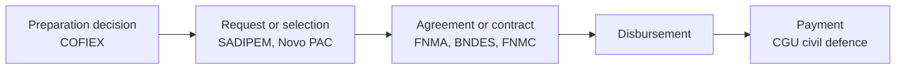

# Review — br-city-finance-feasibility, release v2

## Scope and status

Research, not production-approved. The release is complete as a finance-context catalogue, but most of its project-to-action matches still await human review, and city-level eligibility is not tested. The next decision is whether to adjudicate the Medium-strength matches before the catalogue is shown to cities.

Release v1 scored each pilot city and action into a funding-gap bucket. Release v2 drops that scoring. Cost band is now the only finance field used to order adaptation actions, and the action input is the V13 final action bank (32 scored adaptation actions) rather than the 53-action pilot bank. Everything else in this release is context for city interpretation and project preparation: six finance routes, ten source datasets, observed projects and finance records, and illustrative links from those records to actions. None of it changes the ranking. One notebook builds the record and match tables from the source reviews, then validates all four tables.

The repository is public, so the committed tables hold only records from sources whose licence allows redistribution. Novo PAC, COFIEX and CGU records are withheld while their reuse terms are reviewed: the notebook writes the full catalogue, including them, to the gitignored `sample/` folder for internal analysis. Figures below say which of the two they describe.

| Check | Result | Status |
| ----- | ----- | ----- |
| Rebuilt from source reviews | identical to the tables first published | verified |
| Finance routes | 6 | verified |
| Source datasets | 10 | verified |
| Project and finance records | 3,700 in the full catalogue; 2,623 committed; both include 5 theme-level screens with no amount | verified |
| Project-to-action matches | 3,780 in the full catalogue; 2,700 committed; every one joins to a project | verified |
| Actions with at least one match | 25 of 32, in both tables | verified |
| Matches awaiting human review | 3,216 of 3,780 full; 2,453 of 2,700 committed (all Medium strength) | verified |
| Currencies in committed amount fields | BRL 2,507 / USD 101 / EUR 6 / JPY 4 / none 5 | verified |
| Records withheld from the committed tables | Novo PAC, COFIEX and CGU, pending reuse review | verified |
| Record-level reuse terms | 4 of 10 clear; FNMA and FNMC CC BY with version unstated; Novo PAC, COFIEX, Transferegov and CGU unresolved | unanswered |
| City eligibility per route | not tested | unanswered |

## How finance records relate

Records in this release sit at different points of one finance chain, which is why their amounts cannot be added together. A selection or a credit request is an early signal; a payment is the end of the chain.

*Caption: each source records one or two stages. A record at an early stage says finance was sought or selected, not that money reached the city.*

## What this data supports

The claims are about where finance for adaptation-type activity has flowed in Brazil and through which route. The main caveat is the stage of each record: every figure has to be read with its record type.

"Six finance routes are documented for Brazilian municipalities: domestic climate and environmental grants, domestic climate and infrastructure credit, federal transfers and public investment programmes, direct external development-bank borrowing, international grant facilities, and civil-defence and disaster finance" is supported.

"Each of the six routes has observed Brazilian records, from 19 records for international grant facilities to 1,871 for domestic credit" is supported for the full catalogue, with the record type named alongside any count.

"The catalogue holds 854 BNDES non-automatic financing operations dated 2002 to 2026, including Fundo Amazônia and Fundo Clima records" is supported as a count of contracted operations, not of completed projects.

"743 civil-defence transfer payments were made under MIDR actions 22BO and 8348" is supported, as payments rather than project approvals, from the full catalogue; these records are not committed.

"For a given adaptation action, the catalogue shows examples of how similar activities were described and financed" is supported for 25 of the 32 actions, and only as illustration. Each match carries its type, strength and review state.

## What this data does not support

The overclaim to watch for is reading a record as proof that finance is available to a particular city or action. The catalogue shows past flows; it does not test eligibility and does not predict an award.

Do not say that a route is open to a given city. Actor, geography, sector, call and credit-screen conditions are not checked for any city in this release.

Do not say that a city has a funding probability or a financial-feasibility score. Neither is produced, and past records say nothing about whether a future project will be financed.

Do not add amounts across datasets. Selection, request, contract, disbursement and payment are different stages of the same chain, and amounts are in four currencies.

Do not say that 3,700 (or 2,623) projects were financed. The count mixes credit requests, programme selections, preparation decisions and 5 theme-level screens with records of actual finance.

Do not say that a COFIEX decision is a loan. The 17 COFIEX records authorise preparation of an external operation; none is a signed or disbursed loan.

Do not quote a World Bank or IDB project total as adaptation finance. Lender-side totals cover the whole project, not the adaptation share.

Do not present a Medium-strength match as a recommendation. In the full catalogue 3,216 of the 3,780 matches are drafts awaiting human review, and even the 564 High-strength matches are illustrative rather than evidence that a project should be replicated or that an action is ready.

Do not publish the full catalogue from `sample/`. Novo PAC, COFIEX and CGU records stay withheld until their reuse terms are resolved. The committed tables still carry ODbL records (BNDES, SADIPEM), whose attribution and share-alike obligations apply to any reuse, and CC BY records from FNMA and FNMC with no stated licence version.

## Using it downstream

The project table is the catalogue and the match table is a separate layer on top of it. A project joins to the match table on its reference; most projects have one match and a few have two or three. Always carry the record type with any amount, and keep the illustrative status visible wherever a match is shown to a city.

Filter matches by review status before any city-facing use. The safest default is to show High-strength matches and label the rest as pending review.

Read reuse conditions from the dataset table, row by row, before sharing any extract. This entry inherits the most restrictive upstream licence.

Pair this release with the action adaptation impact review for the action bank, and with the source reviews for extraction and licence detail.

## Benchmark values a city can use

The figures below are comparator priors: typical sizes of what has been sought or funded through each source, in BRL, from the approved-amount field. They show scale, not an offer. CGU and Novo PAC figures come from the full catalogue and are aggregates only. Each row is at the stage its record type describes, so a Novo PAC selection or a SADIPEM request is an amount sought or selected, not paid.

| Source | Stage | Records | Median (BRL) | Middle half (BRL) |
| ----- | ----- | ----- | ----- | ----- |
| FNMA transfer instruments | agreement | 465 | 100,000 | 44,000 to 242,000 |
| CGU civil-defence payments | payment | 743 | 501,000 | 234,000 to 890,000 |
| FNMC projects | fund commitment | 23 | 800,000 | 462,000 to 2.2 M |
| SADIPEM credit requests | request | 1,165 | 8.0 M | 1.7 M to 25 M |
| BNDES financing operations | contract | 854 | 12.7 M | 3.7 M to 45 M |
| Novo PAC selections | selection | 317 | 23 M | 11 M to 50 M |

To understand scale, a small environmental grant (FNMA, FNMC) sits in the hundreds of thousands, civil-defence payments around half a million, and credit and investment programmes in the millions to tens of millions. To replicate, the closest examples are the matched records for the same action, read with their record type. The figures do not generalise to a city's own project cost, because they span different decades, programme cycles and project scopes.

## Notes on non-obvious fields

`record_type` sets the grain of each row. A credit request, a programme selection and a payment are all one row each but mean very different things.

`approved_amount` is the funder's own amount at the stage the record type describes: contracted, committed, requested, selected or paid. It is the funder's share, not the total project cost. `disbursed_amount` is filled only where the source reports money actually paid out, which is BNDES (disbursed) and FNMC (transferred). It is blank for every other source, and a blank means the source does not say, not that nothing was paid. Earlier drafts of these tables filled it with planned or total-cost figures for FNMA, IDB and the World Bank; those are no longer carried.

`currency` is not always BRL. SADIPEM and COFIEX include USD, EUR and JPY operations, and IDB and World Bank are in USD.

`match_strength` and `review_status` move together in this release: every Medium match is pending human review, and every High match is a draft with no further review flagged.

`match_status` holds the same value on every row by design. It exists so the illustrative label travels with any extract.

The five Transferegov rows are theme-level screens, not finance records, and carry no amount.

## Traceability

The source URL is kept on every project and dataset row. The source-specific dataset reviews remain authoritative for extraction, translation, methodology and licence. The notebook rebuilds the release from each source review's clean table and draft action mapping, so every record traces to a source file and a stated rule. Before writing, it asserts the schemas, unique references, the project-to-match join, route and dataset coverage, the record counts in the dataset table, numeric amounts, the controlled match terms and the fixed illustrative status. Sources listed as withheld are read from their reviews' gitignored `sample/` folders; on a fresh clone the notebook skips them and still writes the same committed tables. Match adjudication has not started: no adjudicator or date is recorded yet.

**References**

- Build and validation notebook → `01_finance_context.ipynb`
- V13 action bank (input) → `data/adaptation_action_bank_v13.csv`
- Projects and finance records → `data/projects.csv`
- Project-to-action matches → `data/project_action_matches.csv`
- Full catalogue, all sources (local only) → `sample/projects_all_sources.csv`, `sample/project_action_matches_all_sources.csv`
- Source datasets and reuse conditions → `data/datasets.csv`
- Finance routes → `data/routes.csv`
- Action bank and impact scores → `dataset-review/reviews/oef/br-action-adaptation-impact/`
- Finance source review tracker → `dataset-discovery/needs/2026-09-br-finance-pathways-review/candidates.yaml`
