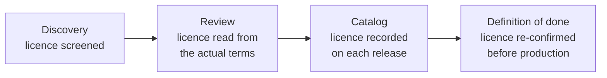

# Licensing of external data, code and content

This page explains what a licence decides for OpenEarth, how licences are checked in the dataset workflow, and the rules and record the team uses for any external asset: datasets, models, images, code and partner material. It is operational guidance, not legal advice. Where a case needs a lawyer or written permission from the publisher, the guide below says so.

## What a licence decides

The licence on a source answers three questions: whether we may copy it into our repos and databases, whether we may publish changed versions of it, and whether we may use it in a product we sell. These questions matter more for OpenEarth than for most teams for two reasons.

First, much of our code is public and licensed under the GNU Affero General Public License v3 (AGPL). Anything committed to a public repository counts as republishing it, so a file with "no redistribution" or "no derivatives" terms is in breach as soon as it is pushed, whatever we later do with it.

Second, several products are moving towards commercial use. A NonCommercial licence does not become acceptable because OpenEarth is a nonprofit or because a tool is free today. If commercial use is planned, NonCommercial material cannot sit in the product.

### Terms used on this page

- **Attribution (BY):** the source must be credited, usually with a set credit line.
- **NonCommercial (NC):** no use in anything sold or used to earn money.
- **NoDerivatives (ND):** the material can be shared only unchanged. Cleaned extracts, translations and mapping tables are changes.
- **ShareAlike (SA):** anything made from the source must be released under the same licence. CC BY-SA, ODbL and AGPL are all ShareAlike. Mixing two different ShareAlike licences can leave a derivative that cannot be licensed at all.
- **Derivative:** anything we make from a source, such as a cleaned extract, a crosswalk or a summary table.
- **SPDX identifier:** the standard short name for a licence, such as `CC-BY-4.0` or `ODbL-1.0`. Used in the catalog so licences can be searched and compared.

## How licences are checked in the dataset workflow

Licences are checked at four points as a dataset moves from discovery to production. Each step builds on the one before.

*Caption: the licence is screened when a source is found, verified when it is reviewed, recorded per release, and confirmed again before any release goes to production.*

At **discovery**, a candidate with unclear licensing is marked "investigate", not rejected. An explicit "no redistribution" term rules a source out for production, though it can still inform the work. At **review**, the licence must come from the publisher's actual terms: a landing page that says "open" or "free to use" is treated as inferred, not verified. In the **catalog**, each release carries its own licence block, because publishers change terms between releases. The **definition of done** requires the licence to be confirmed again for every release before it is marked production-approved.

A dataset under review is not a released dataset. Review folders may hold extracts and notes from sources that are not yet cleared, and the licence check that matters for production happens at the definition-of-done step.

## Traffic-light guide

Every external asset is placed in one of three bands before it enters a product, a production database or a proposal. The band decides what has to happen next.

| Band | Meaning | Typical licences |
|---|---|---|
| **Green** | Use, meeting the stated obligations (usually attribution) | CC BY, CC0, public domain, US government works, most government open data |
| **Amber** | Usable only after a check: permission, licence compatibility, attribution wording or restricted handling | CC BY-SA, ODbL, CC BY-ND, "public information" with no stated licence, unclear terms |
| **Red** | Do not ingest, redistribute, derive from or commercialise without written approval | Anything NC, "no redistribution", all rights reserved |

Amber is the band that needs judgement. ShareAlike terms are the most common reason: they fit open publishing, but whether they can be combined with AGPL code or with each other depends on the case. Amber and red cases go to the licence reviewer rather than being decided by the individual.

Worked example: a government portal publishes programme data under CC BY 4.0. That is green, so it can be ingested, published and used commercially, with the publisher credited. If the same portal's terms say "use permitted for non-commercial purposes with attribution", it is red for any product heading towards commercial use, even though the data is public and free to download.

## Core rules

These six rules apply to every external asset, not only datasets.

1. Committing to a public repository is republishing. Check the licence before committing third-party data or code.
2. Pause on NC, ND, ShareAlike terms that may conflict with AGPL, "no redistribution" and similar restrictions.
3. Free or nonprofit use does not resolve an NC restriction when commercial use is planned.
4. Give attribution whenever it is required. Credit is the default even when it is not.
5. Ask before ingesting when terms are unclear. Removing material later costs more.
6. Record the licence and its version the first time a source is opened, including during exploration and proposal work.

## Minimum licence record

Each source needs one record that answers every licence question. For datasets this is the licence block on each release in the catalog. The first four fields are recorded today; the rest are the proposed additions.

| Field | Recorded today | Purpose |
|---|---|---|
| Source URL | Yes | Where the terms were read |
| Licence identifier and name | Yes | Which licence, using SPDX where one exists |
| Commercial use | Yes | Can it sit in a paid product |
| Note | Yes | Reasoning and any conditions |
| Redistribution allowed | Proposed | Can it be committed to a public repo |
| Derivatives allowed | Proposed | Can changed versions be published |
| ShareAlike | Proposed | Do our derivatives inherit the terms |
| Attribution text | Proposed | The exact credit line to reuse |
| Permission evidence | Proposed | Link to written permission, if any |
| Band | Proposed | Green, amber or red |
| Reviewed by, review date | Proposed | Who checked, and when |

A single commercial-use flag is not enough on its own. CC BY-ND allows commercial use but forbids publishing changed versions, and ODbL allows commercial use but passes its terms on to anything built from it. The proposed fields make those conditions visible.

### References

- Catalog licence fields → `knowledge-base/topics/engineering-standards/documentation-and-metadata.md`
- Release licence check → `knowledge-base/topics/engineering-standards/definition-of-done.md`
- Discovery screening rules → `.cursor/skills/dataset-discovery/references/screening-criteria.md`
- Review licence step → `.cursor/skills/dataset-review/SKILL.md`
- Dataset catalog → `dataset-review/catalog/index.yaml`
- Repo licence → `LICENSE`
